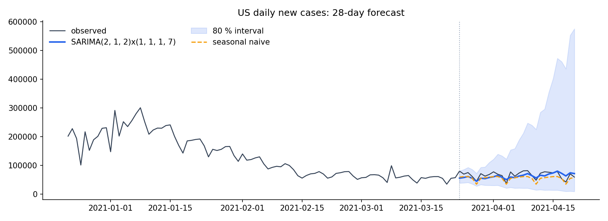

# Forecasting US COVID-19 cases with SARIMA

Forecasts **daily new COVID-19 cases and deaths in the US** 28 days ahead with a seasonal
ARIMA model, and checks whether it actually beats a naive baseline.



## Approach

1. **Data**: the New York Times county-level snapshot (2020-01-21 → 2021-04-20),
   aggregated to a national series (`data/us_national_cumulative.csv`). The NYT figures are
   **cumulative**, so daily counts are first differences.
2. **Transform**: models are fitted on `log(1 + y)`, because counts are skewed and the
   weekly reporting pattern is multiplicative.
3. **Model selection**: SARIMA(p,d,q)×(P,1,Q)₇ with weekly seasonality (strong
   day-of-week reporting effects), chosen by AIC over a small grid.
4. **Evaluation**: the last 28 days are held out. The model is compared against a
   **seasonal-naive baseline** (repeat the last observed week), using MAE, RMSE, MAPE and
   the coverage of the 80 % prediction interval.

## Results (holdout 2021-03-24 → 2021-04-20)

| Series | Model | MAE | RMSE | MAPE |
|---|---|---|---|---|
| New cases | **SARIMA(2,1,2)×(1,1,1)₇** | **10,135** | **12,011** | **15.9 %** |
| | Seasonal naive | 12,373 | 13,782 | 17.9 % |
| New deaths | SARIMA(2,1,2)×(0,1,1)₇ | 339 | 481 | 36.0 % |
| | **Seasonal naive** | **269** | **402** | **29.4 %** |

* For **cases**, SARIMA improves on the baseline by ~18 % MAE. It captures the slow
  upward trend in early April that the flat naive forecast misses.
* For **deaths**, the naive baseline wins. Deaths were falling steadily in this period,
  and the model over-extrapolates. A good reminder to always report a baseline.
* The 80 % intervals cover 100 % (cases) and 93 % (deaths) of observed days, but they
  widen quickly with the horizon. They're too wide to be very useful beyond ~2 weeks.

## Run

```bash
pip install -r requirements.txt
python forecast.py      # ~1 min (grid search); writes docs/*.png and docs/results.md
```

## History

This started as a data-mining course project (UQAR); the original French report is in
[`report/`](report/). The code was rewritten so that it:

* runs on current pandas/statsmodels (`DataFrame.append` and
  `statsmodels.tsa.arima_model` no longer exist);
* models *daily* counts (the original mislabelled cumulative totals as new cases);
* selects orders by AIC and evaluates against a baseline;
* replaces the 52 MB county file with the 12 KB national series it actually uses.
